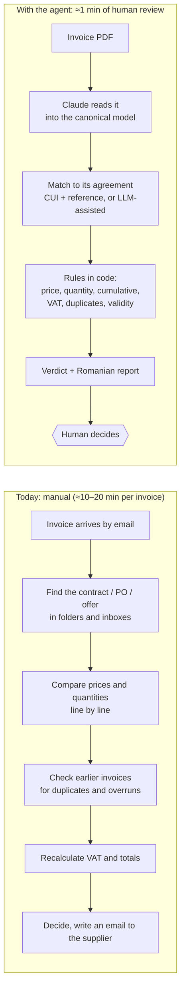
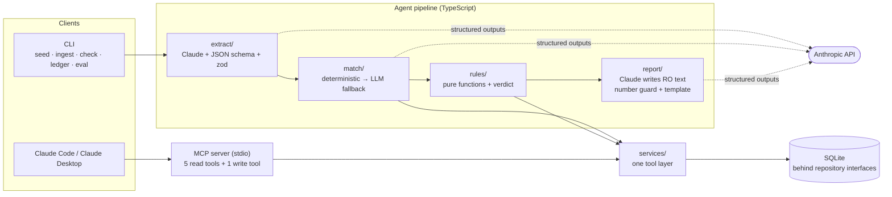
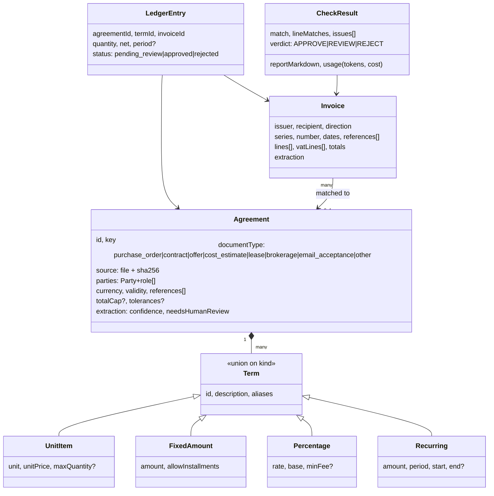

# invoice-check-agent

**Checks every incoming invoice against what was actually agreed, and tells a finance employee, in plain Romanian, whether to approve, review or reject it.**

> Status: **Phase 1 (MVP)**: construction/developer profile, extraction, matching, rules engine, single and batch checks, MCP server, eval harness.
> Phase 2 adds the real-estate agency profile, e-Factura XML, email drafts and full cost reports. Everything in this repository is **synthetic and fictional**.

---

## The problem, in plain language

Before paying an invoice, someone checks it against what the company agreed to pay: *is this the price we negotiated, the quantity we ordered, within the contract period, and not already paid?*

In theory that "what was agreed" is a purchase order. In practice, and especially in small and mid-size Romanian companies, it is spread across many kinds of documents:

| What was agreed lives in… | Typical for |
|---|---|
| a supplier contract with unit prices and maximum quantities | materials (cement, rebar, concrete) |
| a purchase order (*comandă*) | one-off deliveries |
| an accepted offer (*ofertă acceptată*) | subcontracted works, paid in instalments |
| a cost estimate (*deviz*) | finishing works, measured per m² |
| a lease (*contract de închiriere*) | monthly rent |
| a brokerage contract (*contract de intermediere*) | a commission as a % of the sale price |
| an email saying "we accept your offer" | small companies with no POs at all |

That's why this project talks about **reference documents** rather than purchase orders. Every one of them is converted into the same canonical **Agreement**, and invoices are checked against that.

### Today vs. with the agent



The agent **never approves a payment**. `APPROVE` means "recommended for approval", and a person always makes the decision.

---

## Architecture



The design decisions behind this layout:

- **The LLM reads and writes; code decides.** Claude is used only where the input is unstructured. Every comparison, sum and verdict is deterministic TypeScript, so the same input always gives the same verdict, every decision can be audited, and the rules are tested in milliseconds without API calls.
- **The pipeline is a fixed sequence, not an agent loop.** Invoice checking has a known order of steps. A fixed pipeline is cheaper, predictable and easy to evaluate. The model's judgement is used inside three steps, not to choose the steps.
- **One `services/` layer serves two front doors.** The CLI pipeline and the MCP server call the same functions. A Power Automate or HTTP trigger later is just a third adapter.
- **Profiles are configuration.** Accepted document types, active rules and their severity, tolerances, dated VAT rates, alert levels, report language and tone all live in `profiles/*.yaml`, validated at startup.
- **Storage sits behind an interface.** `db/schema.sql` is portable SQL (decimals as TEXT, ISO dates, ULID ids). Moving to SQL Server or PostgreSQL means writing a new repository implementation, not a rewrite.

### What the LLM does vs. what the code does

| Step | LLM (Claude) | Code |
|---|---|---|
| Classify a document | invoice or reference document, which type | rejects types the profile doesn't accept |
| Extract | reads messy and scanned PDFs into a JSON schema (structured outputs) | zod validation, CUI checksum, date and number normalization; any doubt → `needs_human_review` |
| Match agreement | only when references are missing or ambiguous; answer constrained to candidate ids | CUI + reference number + validity scoring; accepts a clear winner without the LLM |
| Match lines | "Ciment CEM II/A-LL 42.5R" ≈ "Ciment Portland CEM II 42.5R"? (one batched call) | exact / alias / token similarity first; unit compatibility |
| Rules & verdict | **never** | all 16 rules, tolerances, cumulative ledger, verdict policy |
| Report | turns computed facts into plain Romanian | number guard: any number not in the facts → deterministic template |

Money is never a float: amounts are decimal strings, and the arithmetic uses `big.js`.

### The canonical model



The model uses `issuer`/`recipient` instead of `supplier`/`buyer` because a real-estate agency *issues* its commission invoices. Each profile declares its own company, and that sets each invoice's direction.

---

## Quick start

```bash
npm install
cp .env.example .env                                   # add ANTHROPIC_API_KEY
npm run seed -- --load-truth                           # fictional PDFs + agreements in the DB
npm run check -- data/synthetic/developer/invoices/I02_materiale_price_over.pdf
```

Without an API key you can still run `npm test`, `npm run eval -- --offline` and `npm run ledger`, and any invoice whose responses are already in the cache.

| Command | What it does |
|---|---|
| `npm run seed [-- --load-truth --reset]` | Generates the synthetic PDFs (one scanned-looking) and ground truth. `--load-truth` stores the agreements without API calls. |
| `npm run ingest -- <file.pdf>` | Extracts a reference document into an Agreement with Claude. |
| `npm run check -- <invoice.pdf> [--profile developer] [--recheck]` | Full check, with a terminal summary and a Romanian report in `reports/checks/`. |
| `npm run check:all -- <folder>` | Checks a folder in name order (order matters for partial deliveries). |
| `npm run ledger` | Invoiced vs. agreed per contract and term, with 80% / 100% alerts. |
| `npm run eval [-- --mode truth-agreements \| --offline \| --fresh]` | Runs the agent on all synthetic documents and writes `reports/eval-YYYY-MM-DD.md`. |
| `npm test` | Unit tests plus an offline end-to-end run over the whole dataset (no API calls). |
| `npm run mcp` | Starts the MCP server on stdio. |

### MCP server (Claude Code / Claude Desktop)

```bash
claude mcp add invoice-check -- npx tsx src/mcp/server.ts
# then ask: "Which contracts are over 80% invoiced?"
```

| Tool | Access | Purpose |
|---|---|---|
| `find_candidate_agreements` | read | agreements that could cover an invoice, scored |
| `get_agreement` | read | full canonical agreement |
| `get_invoiced_to_date` | read | usage per agreement and term, with alerts |
| `list_agreement_usage` | read | all agreements sorted by usage (`minPct: 0.8`) |
| `check_duplicate_invoice` | read | exact or suspected duplicates |
| `record_check_result` | **write** | the only write: stores a result and appends `pending_review` ledger entries |

Read tools use a read-only database connection. The server holds no Anthropic key and makes no LLM calls.

---

## Example report

The agent's output for `I02` (unit price 33,90 instead of the agreed 31,50). This is the deterministic template version; [more samples](reports/samples/).

> ## ⚠️ Recomandare: VERIFICARE MANUALĂ
>
> **Factura MFC 2026-0311** de la **Materiale Ficțiune Construct SRL** (CUI 38123450), din 25.03.2026, total de plată **18.634,00 lei** (15.400,00 lei fără TVA).
>
> Document de referință: contract **CA-2026-014**, valabil 15.01.2026 – 31.12.2026 (potrivire automată după CUI și număr de referință).
>
> ### Ce am găsit
> - Preț unitar mai mare decât cel convenit (rândul 1): 33,90 lei față de 31,50 lei (7,6% peste), adică 960,00 lei în plus pe acest rând.
>
> ### Pasul următor
> Verificați punctele de mai sus (cu responsabilul de achiziții sau cu furnizorul) înainte de aprobare.

---

## Testing and evaluation

The project has three layers of evidence:

1. **Unit tests**: every rule (table-driven), matching, normalization, verdict policy, profile validation, the number guard and extraction normalization. No network.
2. **Offline end-to-end test**: all 11 developer invoices run through the real pipeline (matching, ledger, rules, verdict, persistence), with a ground-truth stand-in for Claude. This proves that the hand-written expectations and the code agree.
3. **`npm run eval`**: the real agent on every synthetic document, scored against ground truth:
   - extraction accuracy per field (invoices and agreements)
   - agreement and line-item matching accuracy
   - issue detection: TP / FP / FN per rule
   - verdict accuracy and a confusion matrix; **"should be flagged but was approved"** is reported as a critical error
   - cost and latency from the `usage` of every API response, per document, per task and per model

The eval runs in a fresh temporary DB, in a fixed invoice order, so cumulative results reproduce. Responses are cached by (model, prompt version, schema, document hash), so re-runs cost nothing. `--fresh` measures real cost. `--models extract=…,match=…` compares model choices.

Models are set per task (`MODEL_CLASSIFY`, `MODEL_EXTRACT`, `MODEL_MATCH`, `MODEL_REPORT` in `.env`). The defaults are Haiku for classification, Opus for extraction, and Sonnet for matching and the report.

### Synthetic dataset (developer profile)

There are 5 fictional suppliers and 6 reference documents (2 contracts, 2 POs, 1 accepted offer, 1 deviz). The 11 invoices cover these cases:

| # | Scenario | Expected |
|---|---|---|
| I01 | clean | APPROVE |
| I02 | unit price 7.6% above agreed + fuzzy line match | REVIEW |
| I03 | quantity above the PO maximum | REVIEW |
| I04–I06 | 3 partial deliveries: 45% → 85% (alert) → 107.5% (overrun) | APPROVE → APPROVE (info) → REVIEW |
| I07 | item not in the deviz (transport) | REVIEW |
| I08 | 12 × 1.450 = 17.400 printed as 17.940 | REJECT |
| I09 | same invoice re-sent by email | REJECT |
| I10 | no reference: the supplier has a contract *and* a PO; the LLM must choose | APPROVE |
| I11 | scanned-looking (image only, no text layer) | APPROVE |

### Results

_To be filled in from `reports/eval-YYYY-MM-DD.md` after the first live run (Phase 2 publishes the full cost report)._

| Metric | Value |
|---|---|
| Verdict accuracy | — |
| Critical errors | — |
| Issue precision / recall | — |
| Cost per invoice (avg) | — |

### Hours saved (editable estimate)

```
hours saved / month = invoices per month × minutes per manual check × share automated ÷ 60
```

Example (replace with your own numbers): 400 invoices × 12 min × 70% ÷ 60 ≈ **56 hours / month**. The cost per invoice comes from the eval report. Phase 2 adds a worked version.

---

## Security and sensitive data (GDPR)

- **What is sent to the Anthropic API:** the document being processed (as a PDF), and for matching and reports, structured summaries such as item descriptions, agreement terms and computed issues. Nothing else from the database is sent.
- **What is stored locally:** extracted agreements, invoices, check results and the ledger in SQLite (`data/*.db`), plus cached model responses in `.cache/llm/`. All of these are git-ignored. The `llm_calls` table logs token counts and costs, **never document content**.
- **Secrets:** the API key is read only from `.env`, and `.env.example` is provided.
- **Least privilege:** the MCP server opens the database read-only for 5 of its 6 tools. The one write tool can only append results and `pending_review` ledger entries.
- **For a real deployment:**
  - use an Anthropic organization with a data-processing agreement and an appropriate retention setting
  - store documents in SharePoint or a DMS with existing permissions, not on a laptop
  - give the database role-based access (finance read and write, others none)
  - set a retention period matching the fiscal-record obligations
  - log who approved what (the ledger `status` transition is the hook for that)
  - keep personal data such as names and IBANs out of logs

---

## Limitations and honest failure modes

- **Extraction can misread a scan.** A misread CUI is caught by the checksum, but a misread quantity that happens to keep the arithmetic consistent is not. Low confidence triggers human review, but confidence is self-reported by the model.
- **Fuzzy matching is a judgement call.** The LLM decides whether "Mortar adeziv" is the agreed "Mortar pentru zidărie". Its answer is constrained to real term ids and comes with a confidence score, and low confidence → REVIEW.
- **Currency conversion is not implemented yet.** An EUR agreement invoiced in RON is flagged for review instead of being converted (BNR rates are Phase 2).
- **The ledger trusts its inputs.** It counts every non-rejected invoice. If a human never moves entries to `approved` or `rejected`, cumulative totals include invoices that may later be rejected.
- **Only PDF input for now.** e-Factura XML (UBL) is Phase 2. It maps into the same `Invoice` model with no LLM needed.
- **The synthetic data is cleaner than reality.** Real documents have handwriting, stamps and multi-page annexes. The eval measures this dataset, not the world.

---

## Roadmap

- **Phase 2:**
  - the real-estate agency profile: brokerage commissions, leases, rent periods
  - e-Factura XML input
  - FX conversion at the BNR rate
  - drafted (never sent) emails for REVIEW/REJECT
  - full eval cost reports and a model comparison
  - a ledger with approve/reject transitions
  - a polished README
- **Phase 3:**
  - a committed `.mcp.json` demo
  - a guide to adding a profile with no code changes
  - roadmap stubs
- **Later integrations:**
  - **ANAF SPV / e-Factura** download of incoming invoices
  - **Outlook / Microsoft Graph** mailbox intake
  - **SharePoint** document storage
  - **Teams** notifications for REVIEW/REJECT
  - a **Power Automate** trigger
  - **ERP** integration (agreements and ledger sync)
  - a **Claude skill** for finance staff
  - a **scheduled daily run** and **monthly report**

---

## Project layout

```
src/domain      canonical model (zod schemas → types), no I/O
src/config      env, profile loader (validates rule params), pricing
src/extract     loose API schemas, prompts, normalization + validation
src/match       normalization, deterministic + LLM matching
src/rules       rule registry, engine, verdict policy
src/report      facts, LLM report, number guard, Romanian template
src/services    the tool layer shared by CLI and MCP
src/pipeline    check-invoice, ingest-reference
src/mcp         stdio MCP server
src/data        repository interfaces + SQLite implementation
src/seed        synthetic dataset spec, PDF + scanned rendering, ground truth
src/eval        runner, scorers, markdown report, ground-truth LLM stand-in
profiles/       company profiles (YAML)
db/schema.sql   portable SQL schema
```
